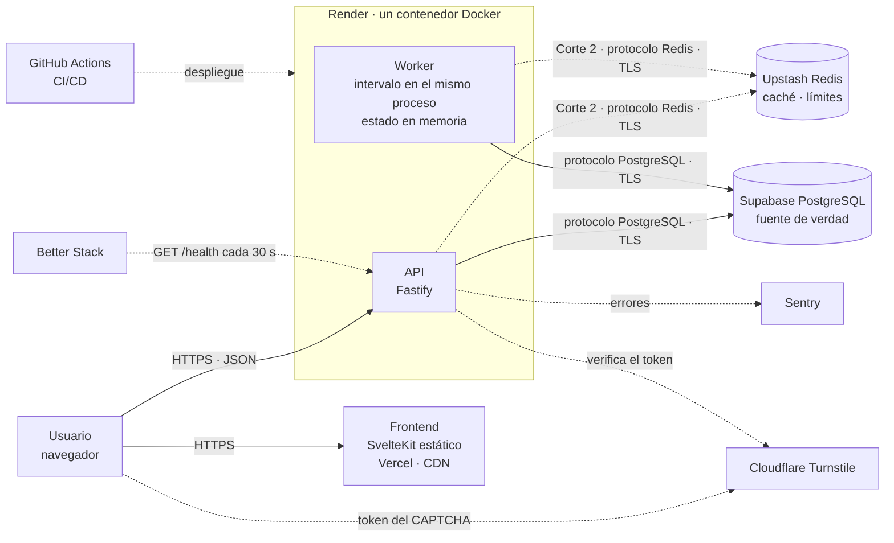

# Arquitectura

Un monolito con un worker: la API y el worker corren en el mismo proceso, dentro de un solo
contenedor (D1). No hay Kubernetes ni microservicios. Este documento muestra cada componente, cómo
se comunica con los demás y qué modelo de servicio usa. La justificación de cada elección está en
la [propuesta](propuesta.md) y en las [decisiones](decisiones.md). Los reportes no pasan por un
stream de Redis (D21).

## Diagrama

Figura 1. Las líneas continuas son el tráfico de la aplicación hoy. Las punteadas son servicios
externos, el despliegue y lo que llega en el Corte 2. La API todavía no usa Redis: el estado vive en
la memoria del proceso hasta que entre la caché (#37). Supabase, Upstash y el servicio de Render están en la
misma región, Oregon (`us-west-2`), para que cada consulta de la API a sus datos no cruce el país.

El navegador descarga el frontend desde la CDN de Vercel y después llama a la API directamente. El
frontend no tiene servidor propio: son archivos estáticos (D3).

## Componentes

| Componente            | Qué hace                                                                                                                      | Con quién se comunica y cómo                                                                                                                                                                       | Hoy                                                |
| --------------------- | ----------------------------------------------------------------------------------------------------------------------------- | -------------------------------------------------------------------------------------------------------------------------------------------------------------------------------------------------- | -------------------------------------------------- |
| Frontend              | Muestra el estado de cada par de bancos, el formulario de reporte y el detalle por banco                                      | El navegador lo descarga de Vercel por HTTPS y desde ahí llama a la API con JSON                                                                                                                   | Estado y reporte (#7, #16). Falta el detalle (#25) |
| API                   | Recibe reportes, los valida, frena el abuso y sirve el estado                                                                 | Recibe HTTPS del navegador. Escribe los reportes en PostgreSQL y lee el estado que el worker deja en memoria. En el Corte 2 lee el estado de la caché de Redis y verifica el CAPTCHA con Turnstile | `/reports` y `/status` (#5, #21)                   |
| Worker                | Recalcula el nivel de cada par de bancos desde PostgreSQL y lo deja en memoria. En el Corte 2 lo escribe en la caché de Redis | Corre dentro del proceso de la API. Lee PostgreSQL. En el Corte 2 también escribe en Redis                                                                                                         | Estado en memoria cada 30 s (#6, #21)              |
| PostgreSQL (Supabase) | Fuente de verdad: bancos, reportes y totales por hora                                                                         | Solo la API y el worker se conectan, con una URL de conexión que vive en las variables de Render                                                                                                   | Migrada y en producción (#8)                       |
| Redis (Upstash)       | Estado temporal: caché del estado con 30 s de vida y contadores de límites                                                    | Solo la API y el worker se conectan, con TLS. Todo lo que guarda se puede reconstruir desde PostgreSQL                                                                                             | Base creada; la API todavía no la usa (#30, #37)   |
| Cloudflare Turnstile  | CAPTCHA invisible contra bots                                                                                                 | El navegador obtiene un token; la API lo verifica contra Cloudflare antes de aceptar el reporte                                                                                                    | Corte 2 (#27)                                      |
| Sentry                | Guarda los errores de la API con su contexto                                                                                  | La API le envía cada error por HTTPS                                                                                                                                                               | Corte 2 (#42)                                      |
| Better Stack          | Monitorea que la API responda y la mantiene despierta (D5)                                                                    | Llama a `GET /health` cada 30 s                                                                                                                                                                    | Corte 2 (#43)                                      |
| GitHub Actions        | CI en cada PR: lint, tipos, pruebas, build y arranque de la imagen, secretos y auditoría. CD al fusionar en `main`            | Lee el repositorio. El job `deploy` llama al Deploy Hook de Render y prueba `/health` (D23)                                                                                                        | CI y CD activos (#41)                              |

## Dónde vive el estado

PostgreSQL es la fuente de verdad: si se pierde, se pierde la historia. El estado de cada par de
bancos vive en la memoria del proceso. Es un estado derivado: el worker lo recalcula desde
PostgreSQL en su primera pasada, apenas arranca el proceso. Por eso un reinicio no pierde datos.
Solo deja `GET /status` en 503 hasta que termina esa pasada.

Ese estado en memoria hace que la API tenga estado propio, y por eso hoy no se pueden agregar
instancias. Cada instancia tendría su propio estado y su propio worker. Además, dos pools con el
valor por defecto de `DB_POOL_MAX`, 10, pasan las 15 conexiones de Supabase (sección 8 de la
[propuesta](propuesta.md)). El camino es llevar el estado a la caché de Redis (#37) y que un solo
proceso corra el worker. Así la API queda sin estado propio y se puede escalar en horizontal (#36).

## Los tres flujos

**Enviar un reporte.** El navegador envía `POST /reports`. La API valida el cuerpo contra el esquema
y guarda el reporte en PostgreSQL. En el Corte 2, antes de guardar, verifica el token del CAPTCHA
(#27) y revisa el límite por dispositivo e IP en Redis (#30). Un stream de Redis delante de
PostgreSQL queda como siguiente paso del análisis de escalabilidad (D21, #36).

**Calcular el estado.** Cada 30 s, el worker lee los reportes de PostgreSQL y recalcula el nivel de
cada par de bancos. Deja el resultado en memoria. En el Corte 2 lo escribe en la caché de Redis
(#37).

**Ver el estado.** El navegador pide `GET /status`. La API responde desde el estado en memoria, sin
consultar PostgreSQL.

## Si algo falla

Así responde el sistema hoy. La sección 7 de la [propuesta](propuesta.md) describe el plan con el
stream de Redis, que salió con D21.

| Falla                                        | Qué pasa hoy                                                                                                                                                                                                                |
| -------------------------------------------- | --------------------------------------------------------------------------------------------------------------------------------------------------------------------------------------------------------------------------- |
| PostgreSQL no responde                       | `POST /reports` responde 503 y el reporte no se guarda: el formulario pide intentar de nuevo. El worker registra el error y conserva el último estado, así que `GET /status` sigue respondiendo. `GET /health` responde 503 |
| El contenedor se reinicia o Render lo duerme | Se pierde el estado en memoria. `GET /status` responde 503 hasta que termina la primera pasada del worker. Los reportes no se pierden: están en PostgreSQL                                                                  |
| Redis no responde                            | No pasa nada: la API todavía no usa Redis. Cuando entren la caché y los límites, el plan es un modo degradado: la API guarda en PostgreSQL con un límite más estricto (#38)                                                 |

Ante una falla de la base, la escritura prioriza la consistencia y la lectura, la disponibilidad:
`POST /reports` no finge que guardó, y `GET /status` sirve el último estado calculado.

`GET /health` consulta la base. Si PostgreSQL falla, un monitor marca toda la API como caída,
aunque `GET /status` siga respondiendo.

## Modelos de servicio

Ninguna pieza usa IaaS (infraestructura como servicio): nadie del equipo administra un servidor, un
sistema operativo ni una red. Cada plataforma se encarga de eso, y el equipo solo entrega código,
una imagen o datos.

| Pieza               | Plataforma            | Modelo | Qué administra la plataforma                                   | Qué administra el equipo                  | Por qué este modelo                                                                         |
| ------------------- | --------------------- | ------ | -------------------------------------------------------------- | ----------------------------------------- | ------------------------------------------------------------------------------------------- |
| Frontend            | Vercel Hobby          | PaaS   | Build, CDN, HTTPS y dominio                                    | El código de SvelteKit                    | Archivos estáticos servidos desde la CDN aguantan un pico de lecturas sin ejecutar código   |
| API y worker        | Render (Docker)       | PaaS   | Servidor, red, HTTPS, reinicios y logs                         | El Dockerfile, el código y las variables  | Corre nuestra imagen sin administrar una máquina; el plan gratuito cubre un servicio        |
| Base de datos       | Supabase PostgreSQL   | DBaaS  | Instalación, respaldos, parches y disponibilidad de PostgreSQL | El esquema, las consultas y los datos     | Una base relacional administrada y gratuita para la fuente de verdad                        |
| Caché y límites     | Upstash Redis         | DBaaS  | Servidor de Redis, persistencia y TLS                          | Qué llaves se guardan y su tiempo de vida | Cobra por comando, así que sin tráfico no consume; no hay un servidor de Redis que mantener |
| CAPTCHA             | Cloudflare Turnstile  | SaaS   | Todo el servicio                                               | La clave del sitio y la verificación      | Construir un CAPTCHA propio no tiene sentido para el problema                               |
| Errores y monitoreo | Sentry y Better Stack | SaaS   | Todo el servicio                                               | Qué se envía y qué alerta                 | Usar el producto listo cuesta $0 en sus planes gratuitos                                    |
| CI/CD               | GitHub Actions        | SaaS   | Las máquinas que corren cada job                               | Los workflows en `.github/workflows/`     | Gratis en un repositorio público, junto al código (D6)                                      |

PaaS: plataforma como servicio. DBaaS: base de datos como servicio. SaaS: software como servicio.
Los límites de cada plan gratuito están en la sección 8 de la [propuesta](propuesta.md).
