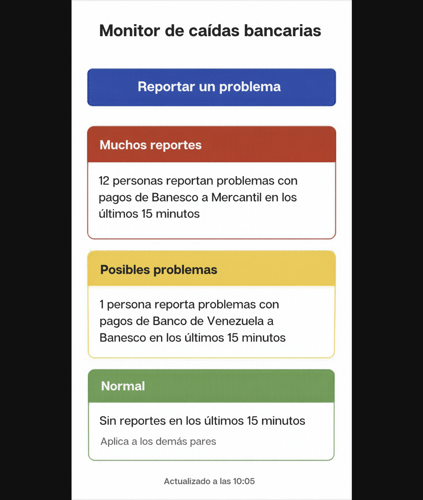
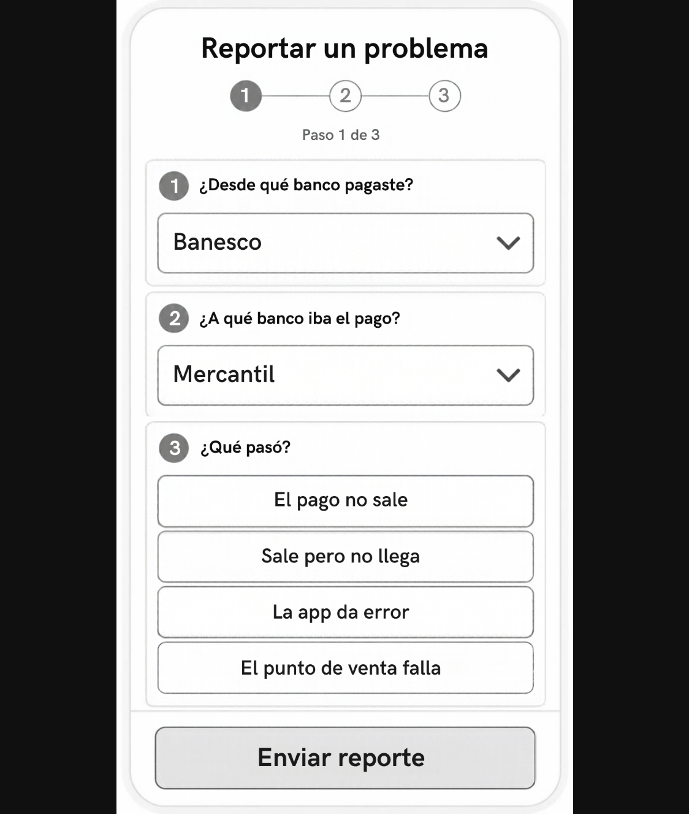
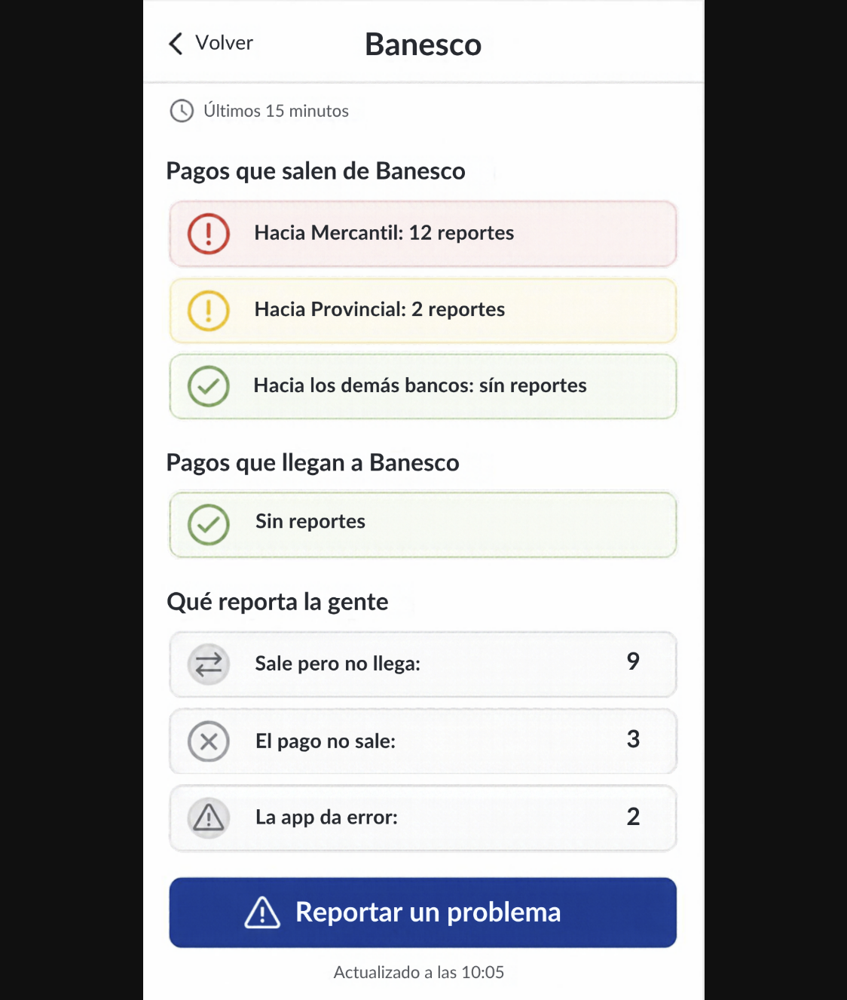

# Bocetos de las pantallas

Bocetos en tamaño de teléfono de las tres pantallas del MVP (#18). Sirven para que el equipo acuerde
cómo se ven antes de programarlas: la pantalla de estado (#7) y el formulario (#16) en el Corte 1, y
el detalle por banco (#25) en el Corte 2.

Los bancos, los tipos de falla y los textos salen de [`docs/api.md`](../api.md).

## Pantalla de estado (R1, R4, R7)

- Cada par de bancos va en una tarjeta con su nivel: rojo para muchos reportes, amarillo para
  posibles problemas y verde para normal.
- Primero los pares rojos y amarillos, y debajo los verdes. Así lo que falla se lee primero, en
  menos de 5 segundos (R7).
- Cada tarjeta muestra el `message` de la API tal cual: "N personas reportan problemas con…". Nunca
  dice que un banco está caído (R4).
- Abajo, la hora de la última actualización.

## Formulario de reporte (R2, R7)

- Tres pasos: banco de origen, banco de destino y qué pasó.
- Qué pasó se elige entre cuatro botones, uno por tipo de falla: el pago no sale, sale pero no
  llega, la app da error y el punto de venta falla.
- Un botón grande "Enviar reporte". No hay que escribir nada: se completa con una mano.
- Al enviar se muestra "Gracias, recibimos tu reporte".

## Detalle por banco (R3, Corte 2)

- Se abre al tocar un banco.
- Dos secciones: los pagos que salen de ese banco y los que llegan a él, cada par con su color.
- Debajo, cuántos reportes hay de cada tipo de falla.
- El botón "Reportar un problema" queda fijo abajo.

## Pendiente de acordar

Los bocetos todavía no reflejan estos puntos. Se ajustan según lo que diga el equipo en el PR.

- **Botón de reportar.** En la pantalla de estado está arriba. La propuesta es dejarlo fijo abajo
  en las tres pantallas, donde llega el pulgar.
- **Pares sin reportes.** La pantalla de estado los resume en una sola tarjeta verde. La propuesta
  es mostrar cada par en su propia tarjeta, debajo de los rojos y amarillos.
- **Preguntas del formulario.** Hablan como quien paga ("¿Desde qué banco pagaste?"), pero también
  reporta el comercio que recibe el pago. La propuesta es algo neutral, como "Banco de origen (de
  donde sale el pago)" y "Banco de destino (a donde llega el pago)".
- **Pasos del formulario.** El indicador dice "Paso 1 de 3", pero las tres preguntas están en la
  misma pantalla. Hay que elegir: una pregunta por pantalla, o una sola pantalla sin indicador.
- **Ventana del detalle.** El boceto dice "Últimos 15 minutos", pero R3 pide los reportes de las
  últimas 24 horas.
